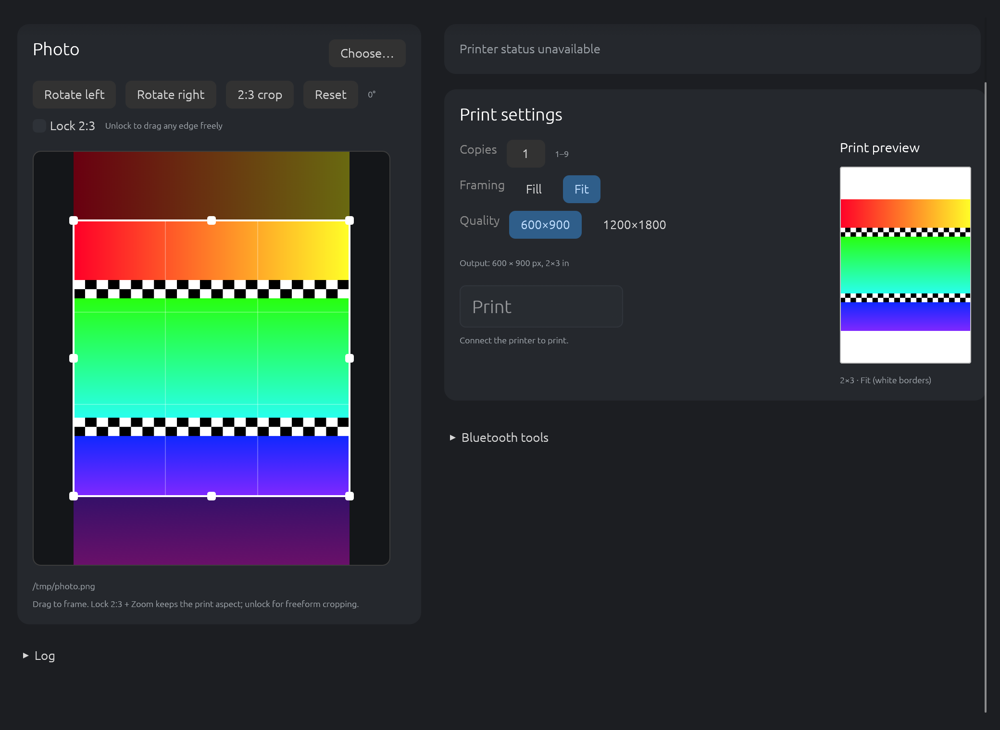

# Liene N200 Pro for macOS

[](https://github.com/bydavy/liene-printer-desktop-app/actions/workflows/ci.yml)
[](https://github.com/bydavy/liene-printer-desktop-app/releases/latest)
[](LICENSE)

An unofficial, open-source macOS app and CLI for the **Liene Pearl N200 Pro**
(DMP130) dye-sublimation photo printer, written in Rust. It talks to the
printer directly over Bluetooth Classic SPP — no vendor app required.


> **Not affiliated with Liene or Hannto.** This is an interoperability project
> for a printer we own. No vendor app code, firmware, or assets are
> redistributed. Liene and Pearl are trademarks of their respective owners.

> **Platform status:** macOS is hardware-tested. Linux and Windows transports
> are implemented and compile-tested in CI, but are **untested with a real
> printer**. Help wanted — see below.

## Platform support

| Platform | Status |
| --- | --- |
| macOS 13+ (Apple Silicon + Intel) | **Tested** on an N200 Pro |
| Linux x86_64 | **Untested** — BlueZ/RFCOMM implementation, CI build, help wanted |
| Windows 10/11 x86_64 | **Untested** — WinRT/RFCOMM implementation, CI build, help wanted |
| Web/WASM (browser) | **Not possible to print** — see below |

## Why there is no WASM build

The UI, protocol, and edit model are portable, but a browser **cannot print to
this printer**, so there is no WASM release:

- The N200 Pro carries print data over **Bluetooth Classic SPP (RFCOMM)**.
  No browser API exposes Bluetooth Classic SPP. Web Bluetooth only supports
  BLE GATT; WebUSB and WebSerial do not expose RFCOMM.
- The printer's USB-C port is charging-only, so there is no USB data path to
  use either.
- The vendor Android app uses BLE only to trigger a reverse SPP connection
  (`A_OUT_<phone-mac>` on `fe95/0013`); that is not a print-data service. A
  pure browser build would need a **BLE GATT print service** on the printer.
  That has not been found or verified on the N200 Pro, and finding one would be
  a separate reverse-engineering and hardware-validation project.
- Even if a GATT data path existed, Web Bluetooth is Chromium-only (no Safari
  or iOS), requires HTTPS and a user gesture, hides MAC addresses, and cannot
  auto-connect. Chunking/ACK behavior would also need to be revalidated for
  BLE (the SPP path uses 892-byte chunks).

Publishing a WASM build today would produce a browser editor that cannot send
a print. The realistic options are:

1. **WASM UI + a local native bridge** — keep the existing Rust SPP transport
   in a small localhost helper/WebSocket server and use the WASM app as its
   frontend. This is a web UI, not a standalone browser app.
2. **BLE GATT transport** — only if the printer exposes a usable print-data
   GATT service; unverified, and still limited to Chromium browsers.
3. **Remote native host** — run the native app near the printer and control it
   over the network.

To port the current code to WASM we would also need to replace the native
transport and pairing, `std::process` helper architecture, blocking threads,
Tokio timers, filesystem image loading, and native file dialogs with Web
Bluetooth/local-bridge, browser File APIs, browser timers, and a WASM-friendly
event loop. The protocol and editing/preview crates are already reusable.

If you know of a BLE GATT data path on any Liene/Hannto model, please open a
[Printer support report](https://github.com/bydavy/liene-printer-desktop-app/issues/new?template=printer-support.md);
that is the only route to a pure browser app.

## Highlights

- **Native macOS app** (egui/Rust) with live printer status, battery, alerts,
  and model/serial/firmware information.
- **Non-destructive editing**: rotate in 90° steps, freeform crop, **Lock 2:3**
  with a 1×–8× zoom/framing slider, and a live **print preview** with white
  borders for Fit.
- **Print pipeline**: EXIF orientation, JPEG compression, 892-byte chunk
  upload, automatic start, and job tracking (`printing`/`finished`/`aborted`).
- **CLI** for scripting and diagnostics: status, info, print, prepare,
  devices, pair, jobs, resume, cancel, raw protocol probes.
- **Documented protocol**: [docs/PROTOCOL.md](docs/PROTOCOL.md) covers frames,
  checksums, JSON-RPC methods, media constants, and the RFCOMM channel.
- **Hardware-verified** on an N200 Pro (model DMP130, firmware 1.0.6_1040).

## Help wanted: testers and more printers

**I'm looking for people with different Liene/Hannto printers to help extend
support.** The N200 Pro (DMP130) is the only model I can test; the protocol may
work on related models, but that is unverified.

Known models from the vendor app's capability table:

| Model | Internal name | PID | Status |
| --- | --- | --- | --- |
| Liene Pearl N200 Pro | `cumin` | 3015 | **Tested** |
| Liene PixCut S1 | `perilla` | 3101 | Untested; help wanted |
| Liene Amber M110/M210 | `laurel` | 3007 | Untested; help wanted |
| Liene Photo Printer | `fennel` | 3005 | Untested; help wanted |
| Portable Photo Printer | `kiwi` | 1021 | Untested; help wanted |

I'm also looking for **Linux and Windows testers** with an N200 Pro.

If you can help, open a
[Printer support report](https://github.com/bydavy/liene-printer-desktop-app/issues/new?template=printer-support.md)
with the model, PID, firmware, OS, what works (status/info/print), and a
`--debug` log. Even a "cannot connect" report is useful. Please remove MAC
addresses, serial numbers, and personal file paths first.

## Requirements

- macOS 13 or newer (tested; Apple Silicon or Intel), or Linux/Windows
  (untested).
- A Liene Pearl N200 Pro and photo paper/ribbon.
- The printer paired with your OS's Bluetooth.

## Install

### macOS (tested)

Download the latest DMG from
[Releases](https://github.com/bydavy/liene-printer-desktop-app/releases/latest), open it,
and drag **Liene N200 Pro** to Applications.

The release is **ad-hoc signed, not notarized**. On first launch, either:

- right-click the app in Finder and choose **Open** (or use
  System Settings → Privacy & Security → Open Anyway), or
- clear the quarantine flag once:

  ```sh
  xattr -dr com.apple.quarantine "/Applications/Liene N200 Pro.app"
  ```

Then allow Bluetooth access when macOS asks. Pair the printer once in
**System Settings → Bluetooth** if it is not already paired (the device is
named `Liene Pearl N200 Pro-XXXX`, where `XXXX` is the last four MAC digits
printed on the label).

The first connection after the printer's Classic link has dropped can take
10–20 seconds while macOS pages the device. The app shows “Connecting…” and
retries automatically.

### Linux (untested)

A Linux x86_64 build is produced by CI as an **untested** artifact (GitHub
Actions → CI → `linux-untested`) or you can build it locally:

```sh
# BlueZ is used for discovery; `sdptool` is optional.
# The transport falls back to the printer's known SPP RFCOMM channel 1.
cargo build --release -p liene-cli -p liene-gui
cp target/release/liene-n200 target/release/liene-n200-app /some/folder/
cd /some/folder && ./liene-n200-app
```

Pair first with BlueZ:

```sh
bluetoothctl --timeout 30 pair <MAC>
bluetoothctl trust <MAC>
bluetoothctl connect <MAC>
```

The GUI looks for `liene-n200` next to its own executable. If you use the
tarball, `./run.sh` does this for you. Linux support is **untested**; please
report results.

### Windows (untested)

A Windows x86_64 build is produced by CI as an **untested** artifact (GitHub
Actions → CI → `windows-untested`) or built with:

```powershell
cargo build --release -p liene-cli -p liene-gui
# keep liene-n200.exe and liene-n200-app.exe together
.\target\release\liene-n200-app.exe
```

Pair the printer in **Settings → Bluetooth & devices → Add device** first.
Windows support is **untested**; SmartScreen may warn because the build is not
code-signed.

## Usage

### App

The app auto-connects to the paired printer and provides:

- **Photo**: drag and drop, or choose a JPEG/PNG.
- **Editing**:
  - Rotate left/right in 90° steps; the crop rotates with the image.
  - **Lock 2:3** keeps the crop at the print aspect. Drag the rectangle to
    move the frame, drag a corner to resize proportionally, or use the
    **Zoom** slider (1×–8×) to frame around its center.
  - Unlock for freeform corner/edge cropping. The outside is dimmed with
    rule-of-thirds guides.
  - **2:3 crop** snaps to the largest centered 2:3 frame; **Reset** starts
    over.
- **Print settings**: copies (1–9), Fill (cover) or Fit (contain), 600×900
  (native) or 1200×1800.
- **Print preview**: the final 2:3 composition next to the settings. With
  **Fit**, the white borders are shown exactly as they will print.
- **Printer status**: state, sub-state, battery, alerts, and model/serial/
  firmware. Recoverable paper/ribbon errors offer **Resume printer**.
- **Progress**: upload frame progress, live job state, print time, and
  cancel/job information.
- **Bluetooth tools**: scan for devices and pair by MAC.
- **Log** panel for diagnostics.



### CLI

```sh
# List paired devices, or scan for nearby devices
liene-n200 devices --scan

# Pair by MAC (or use System Settings / the official app)
liene-n200 pair 11:22:33:44:55:66

# Inspect BLE advertisements and GATT services (diagnostic)
liene-n200 ble --connect

# Query status / device information
liene-n200 status
liene-n200 info

# Print a photo (cover-cropped to 600x900 by default)
liene-n200 print photo.jpg --copies 1

# Rotate/crop while printing
liene-n200 print photo.jpg --rotate 90 --crop 0.1,0.2,0.6,0.5

# Render the exact edited JPEG without printing
liene-n200 prepare photo.jpg --out prepared.jpg --rotate 90 \
    --crop 0.1,0.2,0.6,0.5

# 1200x1800 source canvas; the printer downscales to 300 dpi
liene-n200 print photo.jpg --width 1200 --height 1800 --fit contain

# Don't block until the print finishes
liene-n200 print photo.jpg --no-wait

# Jobs and error recovery
liene-n200 jobs
liene-n200 job 20
liene-n200 resume
liene-n200 cancel 20

# Raw protocol probe
liene-n200 raw get-prop '["printer-state","printer-sub-state","media-size"]'
```

Add `--debug` to dump frame headers and JSON traffic. `liene-n200 serve` is a
hidden JSON-line daemon used by the GUI; it is not normally run by hand.

## How it works

The printer speaks a framed binary protocol over **Bluetooth Classic SPP**
(RFCOMM channel 1), not BLE. JSON control messages and image chunks share the
same framing:

```text
0x7E | version | reserve | connectType | interactive | encoding
     | terminalId u32 | msgSn u32 | pkgTotal u16 | pkgNum u16
     | attributes u16 | body | checksum u8 | 0x7E
```

A print job is `print-job` JSON → 892-byte file chunks (each prefixed with the
4-byte job id) → automatic start. Status uses `get-prop`; job tracking uses
`get-job-info`. The exact fields, constants, and observed responses are in
[docs/PROTOCOL.md](docs/PROTOCOL.md).

### Architecture

```text
crates/liene-protocol/      portable frames, JSON-RPC, chunking (no platform code)
crates/liene-client/        SPP transport, pairing, editing, image pipeline, daemon
crates/liene-cli/           command-line driver + hidden JSON-line `serve` mode
crates/liene-gui/           egui desktop app
vendor/waterkit-bluetooth/  patched transport (direct RFCOMM channel 1)
docs/PROTOCOL.md            recovered protocol reference
```

The GUI spawns the CLI in `serve` mode and talks to it over JSON lines. This
keeps IOBluetooth callbacks on a process whose main run loop actually services
them; winit/eframe's macOS loop does not reliably do so. Both binaries are
bundled in the `.app`.

## Build from source

Requirements: macOS 13+, Xcode Command Line Tools, Rust **1.95+**. Use a
rustup-managed toolchain for universal builds.

```sh
cargo build --release
cargo test

# Host-architecture .app
./scripts/bundle-macos.sh

# Universal (Apple Silicon + Intel) .app
./scripts/bundle-macos.sh --universal

# Compressed DMG with an /Applications shortcut
VERSION=0.1.0 ./scripts/make-dmg.sh
```

Outputs:

- `target/release/liene-n200` — CLI
- `target/release/liene-n200-app` — GUI
- `dist/Liene N200 Pro.app`
- `dist/Liene-N200-Pro-<version>.dmg` and `.sha256`

Linux/Windows packages (untested):

```sh
VERSION=0.1.0 ./scripts/bundle-linux.sh          # on Linux
pwsh ./scripts/bundle-windows.ps1                # on Windows; VERSION env optional
```

CI also publishes `linux-untested` and `windows-untested` artifacts on every
run.

Run the app directly with `cargo run -p liene-gui` or
`open "dist/Liene N200 Pro.app"`.

## Development

```sh
cargo fmt --all -- --check
cargo clippy --workspace --all-targets --locked -- -D warnings
cargo test --workspace --locked
```

CI runs these checks on macOS. Hardware tests require a printer; the unit
tests cover framing, chunking, the edit/zoom model, and the image pipeline.

## Releasing

The release workflow (`.github/workflows/release.yml`) builds a macOS
universal `.app` + DMG, ad-hoc signs them, and attaches the DMG and SHA-256 to
a GitHub Release when a `v*` tag is pushed. Linux/Windows builds are currently
CI artifacts only; they will be added to official releases after testers
confirm the transport. Bump the workspace version and changelog first:

```sh
# edit Cargo.toml [workspace.package] version and CHANGELOG.md
git commit -am "Release v0.2.0"
git tag v0.2.0
git push origin main v0.2.0
```

It can also be run manually (`workflow_dispatch`) to produce a CI artifact.
The build is **not notarized**; enable Developer ID signing and `notarytool`
in the workflow if you have an Apple Developer account.

## Limitations

- macOS is the only hardware-tested platform. Linux (BlueZ) and Windows
  (WinRT) transports are implemented and compile-tested in CI, but have not
  been verified with a printer. Help wanted.
- Pairing on Linux/Windows is handled by the OS tools; the `pair` command is
  macOS-only.
- The N200 Pro uses Classic SPP. A pure browser/WASM frontend cannot print
  directly because Web Bluetooth only supports BLE GATT. A local native bridge
  (or a future BLE GATT path, if the printer exposes one) would be required.
- The Diffie-Hellman/encryption path in the vendor app is not implemented;
  it is disabled by default for this model and the printer accepts plaintext
  frames.
- macOS releases are ad-hoc signed, so Gatekeeper warns on first launch.
  Linux/Windows CI artifacts are unsigned.
- Only the N200 Pro is hardware-tested. Related Hannto printers may share the
  protocol, but that is unverified. Help wanted.

## Troubleshooting

- **Bluetooth permission**: System Settings → Privacy & Security → Bluetooth;
  enable the app and relaunch.
- **Printer not found / stuck connecting**: power-cycle the printer, make sure
  it is paired, and click Connect again. Classic paging can take 10–20 s.
- **“App is damaged”**: use right-click → Open or the `xattr` command above;
  do not disable Gatekeeper globally.
- **Paper/ribbon alerts**: load paper/ribbon, then use Resume printer in the
  app or `liene-n200 resume`.
- **Debugging**: run the CLI with `--debug`, or open the app's Log panel.
  Include the printer model, firmware, macOS version, and the log when filing
  an issue.

## Acknowledgements

Protocol findings were informed by prior community work on the sibling
Liene PixCut S1:

- [sincethestudy/liene-pixcut-s1-api](https://github.com/sincethestudy/liene-pixcut-s1-api)
- [eastbaymakersclub/pixcut-s1](https://github.com/eastbaymakersclub/pixcut-s1)

Built with [eframe/egui](https://github.com/emilk/egui),
[`waterkit-bluetooth`](https://crates.io/crates/waterkit-bluetooth),
[`image`](https://crates.io/crates/image), and the Rust ecosystem. See
[THIRD_PARTY_NOTICES.md](THIRD_PARTY_NOTICES.md).

## Contributing

See [CONTRIBUTING.md](CONTRIBUTING.md). Testers with other printers and
Linux/Windows testers are especially welcome. Security notes are in
[SECURITY.md](SECURITY.md).

## License

MIT — see [LICENSE](LICENSE).
