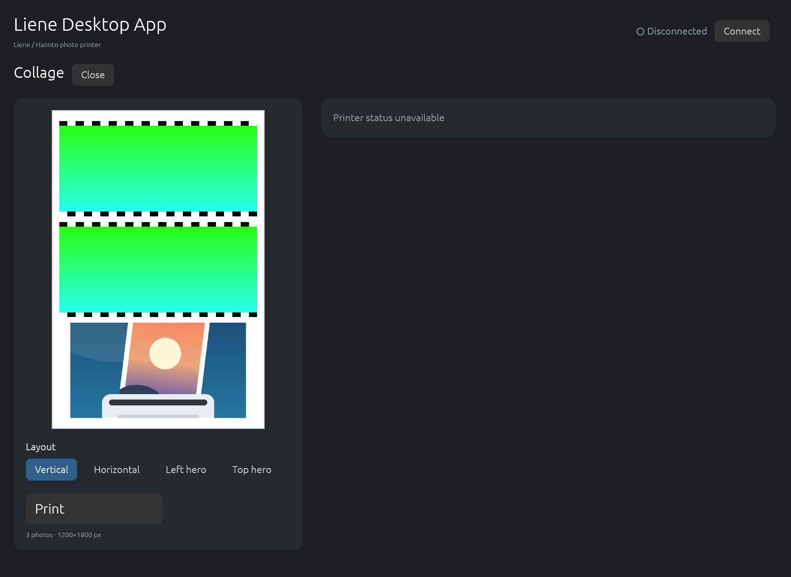

# Liene Desktop App (Unofficial)

[](https://github.com/bydavy/liene-printer-desktop-app/actions/workflows/ci.yml)
[](https://github.com/bydavy/liene-printer-desktop-app/releases/latest)
[](LICENSE)
[](https://ko-fi.com/davyleggieri)
[](https://www.buymeacoffee.com/davyleggieri)

An unofficial, open-source **cross-platform desktop app and CLI for the
Liene/Hannto photo-printer family**, written in Rust. It talks to the printer
directly over Bluetooth Classic SPP — no vendor app required.

Only the **Liene Pearl N200 Pro (DMP130)** has been hardware-tested. Related
Liene/Hannto models use the same protocol family and are implemented, but are
**untested** and may need model-specific media or job settings. macOS is the
only hardware-tested platform; Linux and Windows are implemented but untested.


> **Not affiliated with Liene or Hannto.** This is an interoperability project
> for a printer we own. No vendor app code, firmware, or assets are
> redistributed. Liene and Pearl are trademarks of their respective owners.

> **Platform status:** macOS is hardware-tested. Linux and Windows transports
> are implemented and compile-tested in CI, but are **untested with a real
> printer**. Help wanted — see below.

## Why this app exists

The official Liene app is mobile-only. This project exists to provide a native
**desktop app** for macOS, Linux, and Windows, so you can print from a computer
without transferring the photo to a phone or tablet. It talks to the printer
directly over Bluetooth Classic.

## Platform support

| Platform | Status |
| --- | --- |
| macOS 13+ (Apple Silicon + Intel) | **Tested** on an N200 Pro |
| Linux x86_64 | **Untested** — BlueZ/RFCOMM implementation, CI build, help wanted |
| Windows 10/11 x86_64 | **Untested** — WinRT/RFCOMM implementation, CI build, help wanted |
| Web/WASM (browser) | **Not possible to print** — [why](docs/WASM.md) |

## Supported printers

The app targets the Hannto/Liene photo-printer family. The **Pearl N200 Pro is
the only model I have been able to test**; the other models are recognized from
the vendor app's capability table and share the protocol layer, but their
status is **untested**.

| Model | Internal name | PID | Status |
| --- | --- | --- | --- |
| Liene Pearl N200 Pro | `cumin` | 3015 | **Tested** |
| Liene PixCut S1 | `perilla` | 3101 | Untested; help wanted |
| Liene Amber M110/M210 | `laurel` | 3007 | Untested; help wanted |
| Liene Photo Printer | `fennel` | 3005 | Untested; help wanted |
| Portable Photo Printer | `kiwi` | 1021 | Untested; help wanted |

Other Hannto/Liene models may share the protocol. The app is named **Liene
Desktop App**; the N200 Pro is the tested model. Testers with any of these
printers are very welcome — see below.

## WASM / browser

The UI and protocol are portable, but a browser cannot print to this printer:
it uses Bluetooth Classic SPP, which no browser API exposes. See
[Why there is no WASM build](docs/WASM.md) for the details and the possible
local-bridge or BLE-GATT routes.

## Highlights

- **Native desktop app** (egui/Rust) for macOS, Linux, and Windows, with live
  printer status, battery, alerts, and model/serial/firmware information.
- **Light and dark themes** that follow the system appearance, with a custom
  palette for each.
- **Collage mode**: choose or drop 2–4 photos, pick a vertical, horizontal,
  focused, or grid layout, preview it live, then open a print preview with
  copies.
- **Per-photo framing**: click a photo in the collage preview to zoom, rotate,
  replace, or reset that photo; drag in the frame editor to choose the crop.
  Toggle white borders and randomize the photo order explicitly.
- **Non-destructive editing**: rotate in 90° steps, freeform crop, **Lock 2:3**
  with a 1×–8× zoom/framing slider, and a live **print preview** with white
  borders for Fit.
- **Print pipeline**: EXIF orientation, JPEG compression, 892-byte chunk
  upload, automatic start, and job tracking (`printing`/`finished`/`aborted`).
- **CLI** for scripting and diagnostics: status, info, print, prepare,
  devices, pair, jobs, resume, cancel, raw protocol probes.
- **Documented protocol**: [docs/PROTOCOL.md](docs/PROTOCOL.md) covers frames,
  checksums, JSON-RPC methods, media constants, and the RFCOMM channel.
- **Hardware-verified** on the N200 Pro (model DMP130, firmware 1.0.6_1040);
  the shared protocol targets related Liene/Hannto models, but they are
  untested.

## Help wanted: testers and more printers

**I'm looking for people with different Liene/Hannto printers to help extend
support.** The N200 Pro (DMP130) is the only model I can test; the other models
in the table above need testers, including Linux and Windows users with an
N200 Pro.

If you can help, open a
[Printer support report](https://github.com/bydavy/liene-printer-desktop-app/issues/new?template=printer-support.md)
with the model, PID, firmware, OS, what works (status/info/print), and a
`--debug` log. Even a "cannot connect" report is useful. Please remove MAC
addresses, serial numbers, and personal file paths first.

## Requirements

- macOS 13 or newer (tested; Apple Silicon or Intel), or Linux/Windows
  (untested).
- A supported Liene/Hannto printer and photo paper/ribbon. The N200 Pro is
  hardware-tested; see the supported-printers table for other models.
- The printer paired with your OS's Bluetooth.

## Install

### macOS (tested)

Download the latest DMG from
[Releases](https://github.com/bydavy/liene-printer-desktop-app/releases/latest), open it,
and drag **Liene Desktop App** to Applications.

The release is **ad-hoc signed, not notarized**. On first launch, either:

- right-click the app in Finder and choose **Open** (or use
  System Settings → Privacy & Security → Open Anyway), or
- clear the quarantine flag once:

  ```sh
  xattr -dr com.apple.quarantine "/Applications/Liene Desktop App.app"
  ```

Then allow Bluetooth access when macOS asks. Pair the printer once in
**System Settings → Bluetooth** if it is not already paired (the device is
named `Liene Pearl N200 Pro-XXXX`, where `XXXX` is the last four MAC digits
printed on the label).

The first connection after the printer's Classic link has dropped can take
10–20 seconds while macOS pages the device. The app shows “Connecting…” and
retries automatically.

### Linux (untested)

A Linux x86_64 build is included in [Releases](https://github.com/bydavy/liene-printer-desktop-app/releases/latest)
as an **untested** asset, is produced by CI as an untested artifact (GitHub
Actions → CI → `linux-untested`), or can be built locally:

```sh
# BlueZ is used for discovery; `sdptool` is optional.
# The transport falls back to the printer's known SPP RFCOMM channel 1.
cargo build --release -p liene-cli -p liene-gui
cp target/release/liene-n200 target/release/liene-desktop-app /some/folder/
cd /some/folder && ./liene-desktop-app
```

Pair first with BlueZ:

```sh
bluetoothctl --timeout 30 pair <MAC>
bluetoothctl trust <MAC>
bluetoothctl connect <MAC>
```

The GUI looks for `liene-n200` next to its own executable. If you use the
tarball, `./run.sh` does this for you. Linux support is **untested**; please
report results.

### Windows (untested)

A Windows x86_64 build is included in [Releases](https://github.com/bydavy/liene-printer-desktop-app/releases/latest)
as an **untested** asset, is produced by CI as an untested artifact (GitHub
Actions → CI → `windows-untested`), or built with:

```powershell
cargo build --release -p liene-cli -p liene-gui
# keep liene-n200.exe and liene-desktop-app.exe together
.\target\release\liene-desktop-app.exe
```

Pair the printer in **Settings → Bluetooth & devices → Add device** first.
Windows support is **untested**; SmartScreen may warn because the build is not
code-signed.

## Usage

### App

The app auto-connects to the paired printer and provides:

- **Photo**: drag and drop, or choose a JPEG/PNG.
- **Collage**: use **Collage…** or drop 2–4 images, choose a layout, and tap
  **Print** to open the final preview and copies. Click a photo in the preview
  to frame it; use **Borders** and **Randomize** for layout control.
- **Editing**:
  - Rotate 90° clockwise (repeat to keep turning); the crop rotates with the
    image.
  - **Lock 2:3** keeps the crop at the print aspect. Drag the rectangle to
    move the frame, drag a corner to resize proportionally, or use the
    **Zoom** slider (1×–8×) to frame around its center.
  - Unlock for freeform corner/edge cropping. The outside is dimmed with
    rule-of-thirds guides.
  - **Reset** starts over.
- **Print settings**: copies (1–9), **Fit** (contain, default; white borders)
  or **Fill** (cover; crops to the print). The canvas is always 1200×1800 (2×
  the native 300 dpi output).
- **Print preview**: the final 2:3 composition next to the settings. With
  **Fit**, the white borders are shown exactly as they will print.
- **Printer status**: state, sub-state, battery, alerts, and model/serial/
  firmware. Recoverable paper/ribbon errors offer **Resume printer**.
- **Progress**: upload frame progress, live job state, print time, and
  cancel/job information.
- **Bluetooth tools**: scan for devices and pair by MAC.
- **Log** panel for diagnostics.




### CLI

```sh
# List paired devices, or scan for nearby devices
liene-n200 devices --scan

# Pair by MAC (or use System Settings / the official app)
liene-n200 pair 11:22:33:44:55:66

# Inspect BLE advertisements and GATT services (diagnostic)
liene-n200 ble --connect

# Query status / device information
liene-n200 status
liene-n200 info

# Print a photo (fit into 1200x1800 with white borders by default)
liene-n200 print photo.jpg --copies 1

# Rotate/crop while printing
liene-n200 print photo.jpg --rotate 90 --crop 0.1,0.2,0.6,0.5

# Render the exact edited JPEG without printing
liene-n200 prepare photo.jpg --out prepared.jpg --rotate 90 \
    --crop 0.1,0.2,0.6,0.5

# Fill the page instead of adding white borders
liene-n200 print photo.jpg --fit cover

# Don't block until the print finishes
liene-n200 print photo.jpg --no-wait

# Jobs and error recovery
liene-n200 jobs
liene-n200 job 20
liene-n200 resume
liene-n200 cancel 20

# Raw protocol probe
liene-n200 raw get-prop '["printer-state","printer-sub-state","media-size"]'
```

Add `--debug` to dump frame headers and JSON traffic. `liene-n200 serve` is a
hidden JSON-line daemon used by the GUI; it is not normally run by hand.

## How it works

The printer uses the Hannto/Liene framed protocol over Bluetooth Classic SPP.
See [How it works](docs/ARCHITECTURE.md) for the framing summary, print flow,
crate architecture, and helper-process design; see
[PROTOCOL.md](docs/PROTOCOL.md) for byte-level details.

## Build from source

Requirements: Rust **1.95+**. macOS builds need macOS 13+ and Xcode Command
Line Tools; Linux builds need BlueZ and the GUI development libraries; Windows
builds use the Windows SDK. Use a rustup-managed toolchain for universal macOS
builds.

```sh
cargo build --release
cargo test

# Host-architecture .app
./scripts/bundle-macos.sh

# Universal (Apple Silicon + Intel) .app
./scripts/bundle-macos.sh --universal

# Compressed DMG with an /Applications shortcut
VERSION=0.3.3 ./scripts/make-dmg.sh
```

Outputs:

- `target/release/liene-n200` — CLI
- `target/release/liene-desktop-app` — GUI
- `target/release/liene-control` — authenticated UI control CLI for testing
- `dist/Liene Desktop App.app`
- `dist/Liene-Desktop-App-<version>-macos.dmg` and `.sha256`

Linux/Windows packages (untested):

```sh
VERSION=0.3.3 ./scripts/bundle-linux.sh          # on Linux
pwsh ./scripts/bundle-windows.ps1                # on Windows; VERSION env optional
```

CI also publishes `linux-untested` and `windows-untested` artifacts on every
run.

Run the app directly with `cargo run -p liene-gui` or
`open "dist/Liene Desktop App.app"`.

For deterministic UI tests and screenshots, start the app with `--control` and
use the `liene-control` CLI. It can load images/collages, select layouts, toggle
borders, randomize, set per-photo zoom/pan/rotation, replace photos, take
screenshots, and print. The channel is opt-in, authenticated, and loopback-only.
See [docs/CONTROL.md](docs/CONTROL.md).

## Development

```sh
cargo fmt --all -- --check
cargo clippy --workspace --all-targets --locked -- -D warnings
cargo test --workspace --locked
```

CI runs these checks on macOS, Linux, and Windows. Hardware tests require a
printer; the unit tests cover framing, chunking, the edit/zoom model, and the
image pipeline.

The UI also has `egui_kittest` screenshot and interaction tests for the editor,
collage panel, frame editor, and print preview. Goldens live in
`crates/liene-gui/tests/snapshots` and are recorded/verified with:

```sh
# Compare against the committed snapshots (runs on macOS; other platforms
# skip the pixel comparisons but still run the interaction tests).
cargo test -p liene-gui

# Re-record after an intentional UI change.
UPDATE_SNAPSHOTS=true cargo test -p liene-gui
```

The control channel has headless integration tests covering token rejection,
request forwarding, and discovery-file permissions.

The UI follows the system light/dark appearance. To preview a theme without
changing your OS setting, launch with `LIENE_THEME=light` or
`LIENE_THEME=dark` (also used by the screenshot tooling).

## Releasing

The release workflow (`.github/workflows/release.yml`) builds and attaches:

- a macOS universal `.app` + DMG (hardware-tested; ad-hoc signed),
- a Linux x86_64 `.tar.gz` (**untested**),
- a Windows x86_64 `.zip` (**untested**),

plus SHA-256 files, when a `v*` tag is pushed. Linux/Windows packages are
published for testers and clearly labeled untested. Bump the workspace version
and changelog first:

```sh
# edit Cargo.toml [workspace.package] version and CHANGELOG.md
git commit -am "Release v0.3.3"
git tag v0.3.3
git push origin main v0.3.3
```

It can also be run manually (`workflow_dispatch`) to produce a CI artifact.
The build is **not notarized**; enable Developer ID signing and `notarytool`
in the workflow if you have an Apple Developer account.

## Limitations

- macOS is the only hardware-tested platform. Linux (BlueZ) and Windows
  (WinRT) transports are implemented and compile-tested in CI, but have not
  been verified with a printer. Help wanted.
- Pairing on Linux/Windows is handled by the OS tools; the `pair` command is
  macOS-only.
- The N200 Pro uses Classic SPP. A pure browser/WASM frontend cannot print
  directly because Web Bluetooth only supports BLE GATT. A local native bridge
  (or a future BLE GATT path, if the printer exposes one) would be required.
- The Diffie-Hellman/encryption path in the vendor app is not implemented;
  it is disabled by default for this model and the printer accepts plaintext
  frames.
- macOS releases are ad-hoc signed, so Gatekeeper warns on first launch.
  Linux/Windows CI artifacts are unsigned.
- Only the N200 Pro is hardware-tested. Related Hannto printers may share the
  protocol, but that is unverified. Help wanted.

## Troubleshooting

- **Bluetooth permission**: System Settings → Privacy & Security → Bluetooth;
  enable the app and relaunch.
- **Printer not found / stuck connecting**: power-cycle the printer, make sure
  it is paired, and click Connect again. Classic paging can take 10–20 s.
- **“App is damaged”**: use right-click → Open or the `xattr` command above;
  do not disable Gatekeeper globally.
- **Paper/ribbon alerts**: load paper/ribbon, then use Resume printer in the
  app or `liene-n200 resume`.
- **Debugging**: run the CLI with `--debug`, or open the app's Log panel.
  Include the printer model, firmware, macOS version, and the log when filing
  an issue.

## Acknowledgements

Protocol findings were informed by prior community work on the sibling
Liene PixCut S1:

- [sincethestudy/liene-pixcut-s1-api](https://github.com/sincethestudy/liene-pixcut-s1-api)
- [eastbaymakersclub/pixcut-s1](https://github.com/eastbaymakersclub/pixcut-s1)

Built with [eframe/egui](https://github.com/emilk/egui),
[`waterkit-bluetooth`](https://crates.io/crates/waterkit-bluetooth),
[`image`](https://crates.io/crates/image), and the Rust ecosystem. See
[THIRD_PARTY_NOTICES.md](THIRD_PARTY_NOTICES.md).

## Contributing

See [CONTRIBUTING.md](CONTRIBUTING.md). Testers with other printers and
Linux/Windows testers are especially welcome. Security notes are in
[SECURITY.md](SECURITY.md).

## Support the project

If this app is useful to you, you can buy me a coffee — completely optional:

- [Ko-fi](https://ko-fi.com/davyleggieri)
- [Buy Me a Coffee](https://www.buymeacoffee.com/davyleggieri)

Bug reports, printer test results, and pull requests are just as valuable.

## License

MIT — see [LICENSE](LICENSE).
